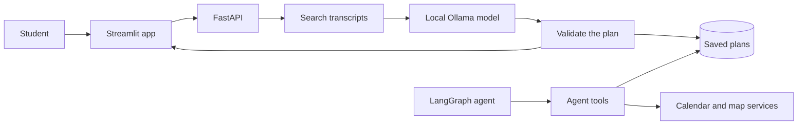

# RepWise

**From training transcripts to a workout plan you can inspect.**

RepWise is a local-first learning project: it searches prepared fitness
transcripts, asks a local Ollama model to draft a plan, checks the plan against
your schedule and equipment, and shows the sources behind it.

It is a prototype for general fitness planning, not a medical or coaching
service. It does not diagnose injuries or guarantee that a plan is safe.

Saved workouts can also be logged with completion and difficulty feedback.
RepWise stores that feedback with the specific workout and can use it to adjust
the next unlogged workout in the same plan, without regenerating the rest of the
plan. Feedback mentioning pain or discomfort is saved without automatically
changing the plan.

## How it fits together



## Try it

You'll need Python 3.11 or 3.12, an authorized prepared transcript corpus, and
[Ollama](https://ollama.com/). Corpus files and model weights are local and aren't
included in this repository. The [setup guide](docs/setup.md) walks through it.

You can also **speak your request**: on the plan tab, use **Record your request**,
then **Use recording**, and edit the text before generating. Recording never submits
a plan by itself. Audio is transcribed locally and never saved.

## The agent

A separate [LangGraph agent](docs/agent/README.md) uses Plan-and-Execute and 15 tools to plan
training, adapt it from feedback, propose calendar slots, find nearby gyms and shops,
and answer from the transcripts. It remembers preferences and past tasks across
sessions. It runs from the command line and isn't part of the app yet:

```powershell
python -m agentic.run_agent --approve
```

## Explore the docs

The [documentation hub](docs/README.md) has one guide per topic. Two good starting
points are [how a request becomes a plan](docs/rag_pipeline.md) and
[what we measured](docs/evaluation.md).

## Important limits

RepWise checks plan structure, schedule constraints, equipment declarations,
and that cited source IDs were retrieved. It does not require exact transcript
quotes, which lets the model use non-English evidence while producing a
coherent English plan. These checks cannot prove that a source supports an
exercise, that advice is medically appropriate, or that the model followed
every instruction.
