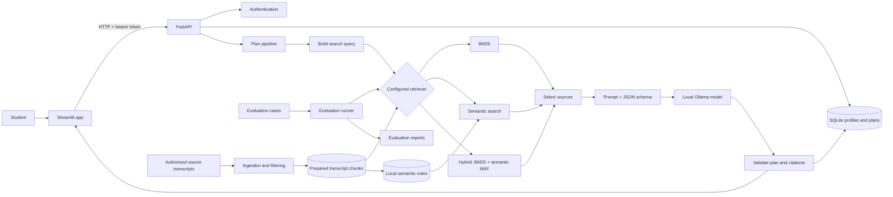

# RepWise

**From training transcripts to a workout plan you can inspect.**

RepWise is a local-first learning project: it searches prepared fitness
transcripts, asks a local Ollama model to draft a plan, checks the plan against
your schedule and equipment, and shows the sources behind it.

It is a prototype for general fitness planning, not a medical or coaching
service. It does not diagnose injuries or guarantee that a plan is safe.

Saved workouts can also be logged with completion and difficulty feedback.
RepWise stores that feedback with the specific workout and can use it to adjust
the next unlogged workout in the same plan, without regenerating the rest of the
plan. Feedback mentioning pain or discomfort is saved without automatically
changing the plan.

## How it fits together



## Try it locally

You’ll need Python 3.11 or 3.12, an authorized prepared transcript corpus, and
[Ollama](https://ollama.com/). Start with the [setup guide](docs/setup.md);
corpus files and model weights are local and are not distributed with this
repository.

## Run the tests

```powershell
python -m pytest -q
```

Some corpus-linkage tests require the prepared local corpus. For evaluation
commands and what the results do and do not show, see the
[evaluation guide](docs/evaluation_protocol.md).

## Explore the docs

Start at the [documentation hub](docs/README.md) for setup, architecture,
generation, retrieval, corpus preparation, API/database details, and
evaluation.

## Important limits

RepWise checks plan structure, schedule constraints, equipment declarations,
and that cited source IDs were retrieved. It does not require exact transcript
quotes, which lets the model use non-English evidence while producing a
coherent English plan. These checks cannot prove that a source supports an
exercise, that advice is medically appropriate, or that the model followed
every instruction.
