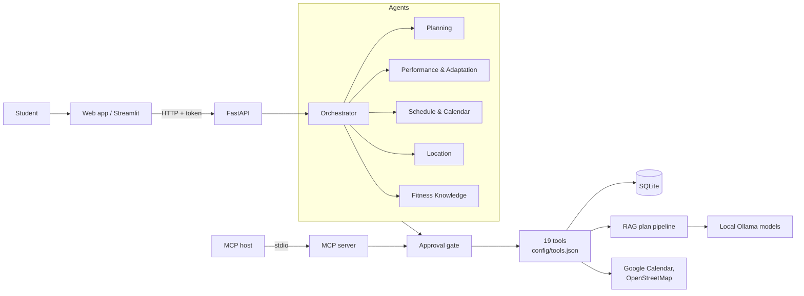

# RepWise

**A local multi-agent fitness assistant whose plans you can inspect.**

RepWise searches prepared fitness transcripts, asks a local Ollama model to
draft a workout plan, checks the plan against your schedule and equipment, and
shows the sources behind it. One orchestrator and five specialist agents also
let you ask for more:

- "Find a gym near me and create a training programme."
- "I missed two workouts; organise the rest of my week."
- "How much rest between sets do the documents recommend?"

Any change to your plan or your calendar waits for your explicit approval.

It is a learning prototype for general fitness planning, not a medical or
coaching service. It does not diagnose injuries or guarantee that a plan is safe.
When you mention pain or injury, RepWise does not change your training
automatically and suggests seeing a health professional.

## How it fits together



| Agent | Does |
|---|---|
| Orchestrator | Reads your profile and plan, decides which specialists to use, coordinates them, and writes one answer. |
| Workout Planning | Generates validated, evidence-based weekly programmes. |
| Performance & Adaptation | Records completed or missed workouts and adjusts the next one within guardrails. |
| Schedule & Calendar | Finds free time in your calendar, moves workouts, and books approved sessions. |
| Location | Finds nearby gyms, fitness equipment shops and supplement shops. |
| Fitness Knowledge | Answers from the curated transcripts, with sources. |

## Quick start

You need Python 3.11 or 3.12, [Ollama](https://ollama.com/) and an authorized
prepared transcript corpus. Corpus files and model weights stay local and aren't
in this repository. The [setup guide](docs/setup.md) has every step.

```powershell
python -m venv .venv; .venv\Scripts\Activate.ps1
python -m pip install -r requirements.txt
Copy-Item .env.example .env        # then set REPWISE_AUTH_SECRET and REPWISE_CHUNK_FILE
ollama pull qwen3.5:9b; ollama pull qwen3.5:4b

python -m uvicorn src.api.main:app --reload          # backend API
python -m streamlit run .\genai_app\streamlit_app.py  # Streamlit UI
python -m scripts.run_agent                           # the agents, on a demo account
python -m pytest -q                                   # tests (no Ollama needed)
```

The MCP server (`python -m src.mcp_server.server`) is optional. It serves the same tools to an
MCP host; see [the MCP guide](docs/mcp.md).

## Documentation

The [documentation hub](docs/README.md) has one guide per topic:

- [architecture](docs/architecture.md)
- [the agents](docs/agents.md), with Plan-and-Execute, memory and approvals
- [the tools](docs/tools.md)
- [the API](docs/api.md)
- [the RAG pipeline](docs/rag_pipeline.md)
- [evaluation](docs/evaluation.md)
- [implementation status](docs/status.md)

## Important limits

RepWise checks plan structure, schedule constraints, equipment declarations, and
that cited source IDs were retrieved. These checks cannot prove that a source
supports an exercise, that advice is medically appropriate, or that a model
followed every instruction.

Agent answers come from a local model. Code checks tool results, approvals and
dates, but the model's wording can still be imperfect. Authentication is suitable
for a local course project and hasn't had a security review; see
[security limits](docs/api.md#security-limits).
