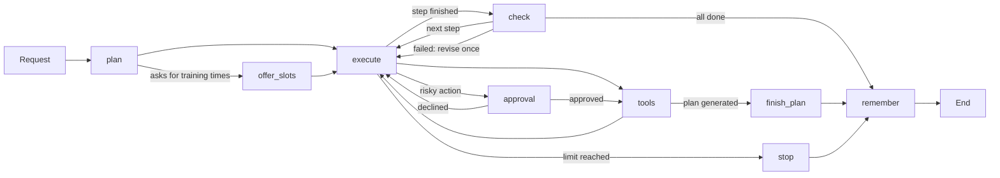

# The RepWise agent

A LangGraph agent with 15 tools, using the Plan-and-Execute strategy. It plans
training, adapts it from feedback, fits it into a calendar, finds nearby gyms and shops,
answers from the fitness corpus, and remembers preferences and past tasks across
sessions. It runs from the command line and isn't part of the app yet.

## Session deliverables

| Session | Deliverable | Where |
|---|---|---|
| 1 | Agent sheet | `Agent Sheet.xlsx` |
| 2 | Tool schemas | [`s2_tool_schemas.json`](s2_tool_schemas.json) |
| 3 | MCP server | [`server.py`](../../server.py), [notebook](../../notebooks/S3_RepWise_MCP_server.ipynb) |
| 4 | Strategy and memory | [Below](#strategy-and-memory) |
| 5 | Agent running on the 5 requests | [`s5_five_requests.md`](../../outputs/agent_runs/s5_five_requests.md) |

The sheet records the original design. Where it differs from the code, such as its
tool names or its "2/3 minutes" limit, this page describes what was built.

## Strategy and memory

The agent uses Plan-and-Execute. It first breaks a request into smaller steps, then
executes them in sequence, checks the outcome, and responds. If a step fails, it revises
its plan. It uses three types of memory:

| Memory | What it stores | Where it lives |
|---|---|---|
| Working | The current task, plan, and tool results. | The graph's state, per thread, until the process ends. |
| Semantic | Stable preferences and useful facts. | SQLite: the student's profile, and `memory_facts` through `remember_fact`. |
| Episodic | Past tasks and decisions. | SQLite: `memory_episodes`, written by code after each request that used a tool. |

Facts and recent tasks are added to the prompts as background, so tools still supply
current data. Pain and injury details aren't remembered, and the student ID comes from
the session, never from the model. Plans, feedback, and other training data stay in
their own tables, reached through the tools.

## Run it

```
python -m agentic.run_agent --approve              # the 5 requests
python -m agentic.run_agent --all-tools --approve  # each tool and memory, in sequence
```

Leave out `--approve` to answer each approval yourself. Both need Ollama and the local
corpus. They use a temporary database with a synthetic account, a fake calendar, and a
fixed location (Cachan), which is sent to the map service. Each run overwrites its
transcript in [`outputs/agent_runs/`](../../outputs/agent_runs).

## How a request runs



| Node | What it does | Decided by |
|---|---|---|
| `plan` | Loads memory, then breaks the request into at most 5 steps, each naming the tool it must call, if any. | Model. If its plan is unusable, one step covers the whole request. |
| `execute` | Runs the current step, calling tools until its work is done. The last step writes the answer. | Model |
| `check` | Passes a step only if the tool it names ran and succeeded. A failed step revises the plan once; a second failure adds a note to the answer. | Code |
| `remember` | Saves an episode of what happened, from the tool results rather than the model's words. | Code |

| Rule | How it works |
|---|---|
| Limits | Checked between steps. A running step isn't interrupted, but model calls time out after 3 minutes. The clock restarts after an approval. |
| Approval | Needed before a new plan replaces an active one, before saving feedback that mentions pain, and for each tool marked below. A declined action doesn't run. |
| Workout programs | The program's focus is the student's latest message, so a follow-up such as "and my back?" is taken literally. Code shows the validated plan and any free slots, without another model call. |
| Training times | Requests for them skip the model's planning and run `propose_training_slots` first, so the model shows real dates instead of working them out. It's a phrase match in `ASKS_FOR_SLOTS`, so unusual wording goes to the planner. |
| Declined actions | The request ends there, with no revision, so a refusal is never retried. |
| Warnings | Code adds the notes that must reach the student, such as a workout moved to another day. |
| Identity | The student, location, and calendar come from `AgentContext`. They aren't parameters the model sees. |

## Tools

Exact schemas, as the model sees them, are in
[`s5_agent_tools.json`](s5_agent_tools.json). A test fails if they drift from the code.

| Tool | Type | Approval | What it does |
|---|---|---|---|
| `get_user_profile` | read | | The student's goal, days, equipment, and preferences. |
| `get_timetable` | read | | Available days and the latest plan's workouts. |
| `save_workout_feedback` | write | If it mentions pain | How one workout went. |
| `generate_workout_plan` | write | If replacing a plan | Generates and saves a plan through the [RAG pipeline](../rag_pipeline.md). |
| `find_nearby_places` | read | | Gyms and shops, nearest first, from OpenStreetMap. |
| `get_workout_history` | read | | Logged workouts across plans, with counts and pending recommendations. |
| `search_documents` | read | | Passages from the corpus. Refuses pain and injury questions. |
| `log_workout_performance` | write | | Weights, sets, and reps for one workout. |
| `save_recommendation` | write | | Keeps an idea for later, without changing the plan. |
| `remember_fact` | write | | Keeps a preference or fact for later conversations. Refuses pain and injury details. |
| `update_upcoming_workout` | write | Yes | Adapts the next unlogged workout, using the API's adapter and rules. |
| `organize_schedule` | write | Yes | Moves workouts to other available days. All the moves apply, or none do. |
| `get_calendar_busy` | read | | Busy times, never event titles. |
| `propose_training_slots` | read | | Free times for the latest plan, found by code. |
| `add_workouts_to_calendar` | write | Yes | Rechecks each time, then creates the events. A retry can't duplicate them. |

| File in `agentic/` | What's in it |
|---|---|
| [`agent.py`](../../agentic/agent.py) | The graph, the system prompt, and `ask()`. |
| [`planning.py`](../../agentic/planning.py) | Making and revising plans, and checking each step. |
| [`memory.py`](../../agentic/memory.py) | Semantic and episodic memory. |
| [`agent_tools.py`](../../agentic/agent_tools.py) | The tool list, and the arguments the model may supply. |
| [`tools.py`](../../agentic/tools.py) | Profile, timetable, and feedback. These are also on the MCP server. |
| [`training_tools.py`](../../agentic/training_tools.py) | History, adaptation, schedule, recommendations, and search. |
| [`calendar_tools.py`](../../agentic/calendar_tools.py) | Busy times, slots, and bookings. |
| [`google_calendar.py`](../../agentic/google_calendar.py) | The Google connection. |
| [`places.py`](../../agentic/places.py) | Nearby gyms and shops. |
| [`call_tool.py`](../../agentic/call_tool.py) | Runs one tool alone, for debugging. |
| [`run_agent.py`](../../agentic/run_agent.py) | Runs the requests and writes the transcripts. |

## Debug a tool

Each tool is a plain function that returns a pydantic result, or a failure with a
`code`. To run one alone, on demo data and a fake calendar, without a model:

```
python -m agentic.call_tool --list
python -m agentic.call_tool propose_training_slots
python -m agentic.call_tool update_upcoming_workout "{\"week_number\": 1, \"workout_index\": 0}" --logged
python -m agentic.call_tool get_workout_history --debug
```

`--logged` first saves feedback on the first workout. In an agent run, `INFO` logs each
tool's name, status, and duration, and `DEBUG` adds its arguments and output. After
changing a tool, run `python -m agentic.call_tool --write-schemas`.

## Connect Google Calendar

This hasn't been run against a real account yet, and the demo uses a fake calendar.

1. In a Google Cloud project, enable the Calendar API, configure the consent screen,
   and add yourself as a test user. Access expires after 7 days in testing mode.
2. Create an OAuth client of type "Desktop app", and save its JSON as
   `data/google/client_secret.json`. Git ignores that folder.
3. Run `python -m agentic.google_calendar connect "Your account name"`, then
   `python -m agentic.google_calendar check "Your account name"`, which only reads.
4. Pass `load_google_calendar(student_id)` as `calendar` in `AgentContext`.

Tokens are stored unencrypted in `data/google/tokens/`, which suits local use only.

## Known limits

- **Login:** `agentic/tools.py` and the MCP server trust the `student_id` they receive,
  so use them only on your own machine. The agent takes it from `AgentContext`.
- **Adaptation:** approval comes before the change is generated, so the student sees the
  before and after only once it's saved.
- **Moved workouts:** `organize_schedule` doesn't move calendar events. The student is
  told to change them.
- **Search:** `search_documents` skips the plan pipeline's scope check, which refuses
  knowledge questions, so an off-topic question can return unrelated passages.
- **Places:** results don't show stock and can include private venues. `try_first` reads
  shop names only.
- **Checks:** `check` tests only the tool a step names. A step the planner left without
  one isn't checked, and a step passes if an earlier step ran the same tool
  successfully, so a claim can still get through.
- **Memory:** a student can't yet list or delete single memories, only delete their
  account. Episodes have no expiry, and recall takes the newest rather than the most
  relevant. Health details are filtered by keywords, so other wording can be stored.
- **MCP:** only `get_user_profile`, `get_timetable`, and `save_workout_feedback` are on
  the MCP server. See it work with `python -m agentic.mcp_demo_client`, or test your
  model's tool choice with `python -m agentic.llm_check`.

## Tests

`python -m pytest tests\agentic tests\tools -q` needs neither Ollama nor a network, so
it checks the code, not the model's choices. The real-model runs above check those, and
their PASS is a check of tool choice, time, and results, not of answer quality.

To add a tool, write the function, add it to `build_tools` in `agent_tools.py`, then run
`python -m agentic.call_tool --write-schemas`. The planner and executor pick it up from
that list, so the graph doesn't change.
