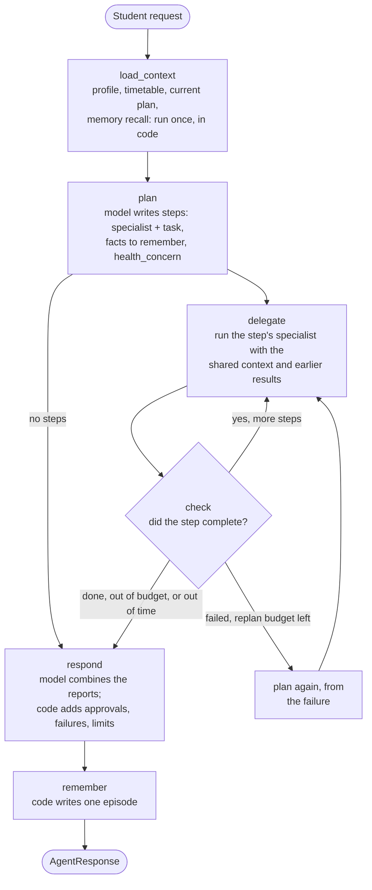
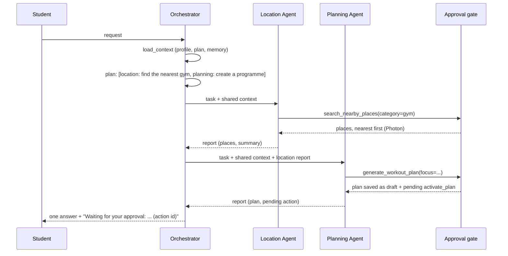

# The RepWise agents

RepWise answers free-text requests with **one Orchestrator Agent and five
specialists**, as specified in the
[completed agent sheet](agent/RepWise_Completed_Agent_Sheet.xlsx). The
orchestrator follows the Plan-and-Execute strategy and the three-layer memory
design of [Planning and Memory](agent/Planning_and_Memory.md).

| Agent | Responsibility | Tools ([catalog](tools.md)) |
|---|---|---|
| **Orchestrator** ([`orchestrator.py`](../src/agents/orchestrator.py)) | Reads the context, plans which specialists to use and in what order, delegates, checks each step, replans once if needed, and writes one answer. It has no training or calendar writes. | `get_user_profile`, `get_current_plan`, `get_timetable`, `get_workout`, `remember_fact` |
| **Workout Planning** | Personalised weekly programmes through the RAG pipeline. Draft or active plans. | `generate_workout_plan`, `activate_plan`, `get_workout_history`, `save_recommendation` |
| **Performance & Adaptation** | Records completed, partial and missed workouts, analyses progress, adjusts the next workout within guardrails. | `save_workout_feedback`, `log_workout_performance`, `update_upcoming_workout`, `get_workout_history`, `save_recommendation` |
| **Schedule & Calendar** | Free slots in the connected calendar, moving workouts between days, booking approved sessions. | `get_calendar_busy`, `propose_training_slots`, `organize_schedule`, `add_workouts_to_calendar` |
| **Location** | Nearby gyms, fitness equipment shops and supplement shops. | `get_location`, `search_nearby_places` |
| **Fitness Knowledge** | Evidence from the curated transcripts, with sources, kept apart from interpretation. | `search_documents` |

The five specialists are defined in [`specialists.py`](../src/agents/specialists.py).
Each has a short set of rules, and all of them share one bounded tool loop. A
specialist is offered **only its own tools**, and a call to any other tool is
refused (`not_allowed`).

## Plan-and-Execute



1. **Understand and gather context.** `load_context` runs the orchestrator's read
   tools once and recalls memory. The result is the *shared context*, so a
   specialist never re-reads the profile or the plan.
2. **Plan.** The model returns an `OrchestratorPlan`. That is a list of
   `Delegation(agent, task, workout?)`, plus facts the student asked to remember
   and a `health_concern` flag. Code caps it at `REPWISE_AGENT_MAX_DELEGATIONS`
   steps (4 by default). The model first classifies the request (`request_kind`:
   `saved_data`, `greeting` or `needs_specialists`). If it says specialists are
   needed but plans none, code asks once more, and then asks a simpler question
   whose answer must be one specialist name (or `none`). When no specialist runs,
   the final answer is told that no documents were searched and may not cite
   any.
3. **Execute.** Each step runs one specialist, a small LangGraph loop:
   `think → act → think … → done`.
4. **Validate.** `check` reads the specialist's report, not its prose. A step
   *fails* when the model could not be reached, or when tools were called and none
   succeeded. A safety refusal (such as a refused health question) counts as
   handled, not failed.
5. **Replan.** One failed step triggers one revised plan for the remaining work
   (`REPWISE_AGENT_MAX_REPLANS`). The planner sees the failure and the steps
   already done.
6. **Approve.** Consequential writes are held as pending actions (see
   [Approvals](#approvals)). The specialist reports them, and the answer lists
   them.
7. **Respond.** The model writes one answer from the reports and the tool
   results. Code then appends what must not be lost: the places found (nearest
   first) and the proposed free times, pending approvals with their IDs and exact
   changes, failed steps, steps skipped by a limit, and the medical-advice notice
   when relevant. The model is told not to repeat or reorder those lists.
8. **Remember.** Code writes an episode.

### Limits

Every loop is bounded, so a run cannot go on forever:

| Limit | Default | Variable |
|---|---|---|
| Specialist steps per request | 4 | `REPWISE_AGENT_MAX_DELEGATIONS` |
| Plan revisions per request | 1 | `REPWISE_AGENT_MAX_REPLANS` |
| Tool calls per specialist task | 5 | `REPWISE_AGENT_MAX_TOOL_CALLS` |
| Time per specialist task | 240 s | `REPWISE_AGENT_SPECIALIST_SECONDS` |
| Time per request | 420 s | `REPWISE_AGENT_REQUEST_SECONDS` |

The sheet proposed five steps and 15–30 s for the orchestrator. That doesn't fit a
multi-agent request on a local 9B model: generating a plan alone takes about one
to two minutes. So the limits are counted per specialist (five tool calls, as the
sheet asks) and the time budgets are larger. All of them are configurable.

### Two multi-agent requests

**"Find a gym near me and create a training programme."**



**"I missed two workouts; organise the rest of my week."** The Performance Agent
records both workouts as `not_completed` (history is kept; nothing is adapted).
The Schedule Agent then calls `organize_schedule` with `catch_up_week` (and
`from_day`, today's weekday, for the current week). Code, not the model, decides
the moves: the missed workouts go first onto the available days left in the
week, then the workouts not done yet; one that no longer fits takes a day that
has passed and is skipped that week. The moves are computed before approval, so
the approval message lists each one ("Week 1: Lower body, Monday (missed) →
Friday.") and the stored action holds exactly those moves.

### Key facts computed by code

A small model mixes up *available days* (when the student can train) and
*workout days* (what the plan schedules), and miscounts them. The shared context
therefore starts with a **Key facts** block written by code: today's weekday,
the available days, each week's workouts with their logged status, and the
available days without a workout. Every agent and the final answer see it, and
the answer prompt says these lines are always right and must not be
contradicted.

### Sharing context between agents

Agents don't talk to each other directly. The orchestrator passes each specialist
a text context with:

- today's date and time zone;
- the profile;
- the current plan's timetable, with IDs, logged and booked status;
- recalled memory;
- the workout the step is about, if any;
- a digest of earlier steps' reports.

A digest carries each specialist's summary, its **structured tool results** and
its pending actions. A later agent therefore relies on facts (the gym's name, a
`plan_id`) and not on another model's paraphrase. Specialists never see the
account ID, tokens or credentials.

## Approvals

Approval rules come from the catalog (`approval` in
[`config/tools.json`](../config/tools.json)), and one module,
[`approvals.py`](../src/agents/approvals.py), applies them:

| Operation | Example | What happens |
|---|---|---|
| Read | `get_timetable`, `search_nearby_places` | Runs. |
| Recommendation or draft | `save_recommendation`; `generate_workout_plan` while a plan is active | Runs, and changes nothing the student follows. A draft plan gets a pending `activate_plan` automatically. |
| Approved write | `organize_schedule`, `add_workouts_to_calendar`, `update_upcoming_workout`, `activate_plan`; feedback that may mention pain | Held as a **pending action**. Runs only when the student approves that action ID. |
| Failed or rejected | Invalid arguments, a declined or expired action | Returns a `ToolFailure` or an `ApprovalError`. Nothing runs. |

A pending action stores the exact tool, the exact validated arguments (with their
SHA-256 hash), the reason, the proposing agent, the owning account and an expiry
(`REPWISE_APPROVAL_MINUTES`, 30 by default). Approving one:

- works only for the account that owns it. Any other account gets *not found*;
- re-checks the hash, so tampered arguments are refused;
- changes the status from `pending` to `approved` in one conditional update, so it
  can't run twice;
- runs the stored call and records `executed` (or `failed`) with its result.

A model saying "yes" is never an approval. Only an authenticated
`POST .../approve` is.

### Contract for the frontend

The Streamlit app (`genai_app/`) already uses this contract; the web frontend
(`app/`) can use the same routes,
documented with their status codes in [API and database](api.md#agent-routes):

1. `POST /api/v1/students/{id}/agent/requests` with `{"message", "conversation_id"?,
   "location"?, "timezone"?}`. Show `answer`. For each item in `pending_actions`,
   show its `reason` with Approve and Decline buttons.
2. `POST /api/v1/students/{id}/agent/actions/{action_id}/approve` (or `/decline`).
   The response has the action's final status and the tool's `result`. Refresh the
   plan view after an approval.
3. `GET /api/v1/students/{id}/agent/actions` lists the pending actions, for example
   after a reload. Pass `conversation_id` back to continue a conversation.

## Memory

| Layer | Holds | Where | Lifetime |
|---|---|---|---|
| Working | Request, plan, current step, specialist reports, shared context | LangGraph state | One request. Conversation turns are kept per `conversation_id` in the process, so a follow-up has context. |
| Semantic | Stable preferences and facts the student **asked** RepWise to remember | `memory_facts` | Until the account is deleted. Profile data (goal, days, equipment) is not copied here. |
| Episodic | One code-written line per request that used a specialist: what was asked, what completed, what waits for approval, what failed | `memory_episodes` | **90 days** (`REPWISE_EPISODE_RETENTION_DAYS`). Older episodes are deleted when a new one is saved and are never recalled. |

The planning document left retention open ("maybe 90 days"). The final policy is
90 days, configurable.

Memory is recalled into the planner's and the specialists' context as background,
under a heading that says it isn't an instruction. Every query is scoped to the
authenticated account.

**Health details never enter long-term memory.** `remember_fact` refuses them, and
an episode for a request flagged as health-related stores a neutral placeholder
instead of the request.

## Pain, injury and medical questions

RepWise gives general fitness guidance, not medical advice. A single **health
check** ([`health.py`](../src/agents/health.py)) decides whether text mentions
pain, injury, illness, medication or another health issue. It sends the text to a
small local Ollama model (`REPWISE_HEALTH_CHECK_MODEL`), which answers in a strict
JSON schema, in English or French. Normal effort ("too hard", "c'était dur") isn't
a concern.

- **It replaces the old keyword lists.** A model also catches indirect phrasing
  ("my knee clicked and swelled", "une gêne à l'épaule").
- **It fails closed.** If the model is unreachable or answers badly, the text is
  treated as a *possible* concern. An unnecessary approval costs one click; an
  automatic load change after an injury could hurt someone.
- **It runs once.** Feedback is checked when it is saved, and the decision is stored
  with it. Adaptation and history read the stored flag.

It is used in five places:

1. feedback saved through the API or an agent (stored flag; no automatic adaptation);
2. the approval rule for agent feedback;
3. `remember_fact`;
4. episodic memory;
5. `search_documents`, which refuses the question.

The orchestrator's planner also flags `health_concern`. That adds the
medical-advice notice to the answer and tells specialists not to increase training
load.

## Running the agents

```powershell
# The agent sheet's five requests, real model, synthetic account, fake calendar:
python -m scripts.run_agent
# The multi-agent scenarios; --approve also approves every pending action:
python -m scripts.run_agent --multi --approve
```

Transcripts are written to `outputs/agent_runs/`. The PASS check is mechanical:
it checks which specialists and tools ran, not the quality of the answer. Through
the API, use `POST /api/v1/students/{id}/agent/requests`.

## Measurements

Every response carries `metrics` ([`metrics.py`](../src/agents/metrics.py)):

- the time of each orchestrator phase;
- every model call (plan, replan, specialist turns, final answer) with its duration
  and the input and output tokens Ollama reports;
- each tool call's latency;
- totals.

The Streamlit **Assistant** tab shows them under each answer. The **Metrics** tab
collects every request of the session, with CSV and JSON export for evaluation.

## Tests

- `tests/agents/` uses a scripted model (`tests/conftest.py`) to cover the
  specialist loop, plan-and-execute, replanning, limits, routing of the sheet's
  requests, the multi-agent scenarios, approvals, memory and the health check.
- `tests/integration/test_live_services.py` runs against the real Ollama, Photon
  and corpus when `REPWISE_LIVE_TESTS=1`.
