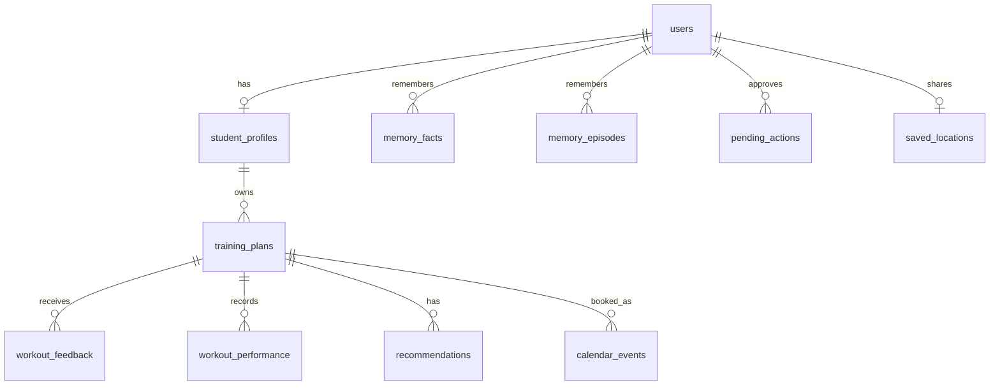

# API and database

The API is the only way into RepWise's data over HTTP (the [MCP server](mcp.md) is
the other, local, entry point). The frontends keep the token and account
ID in their session and sends them with each request, so users never type an ID. The
interactive reference is at `http://127.0.0.1:8000/docs` when the API is running.

## Accounts

1. `POST /api/v1/auth/register` takes a unique full name and a password of at least
   eight characters. It creates a UUID account ID and stores only an Argon2 hash.
2. `POST /api/v1/auth/login` checks the password against that hash.
3. Both return a signed JWT, the account ID, and the full name. Tokens last one hour.
4. Other routes get the account ID from the token and require it to match the
   `student_id` in the URL, so changing a URL grants no access. Updates and deletes
   also filter on the owner.

Without `REPWISE_AUTH_SECRET`, registration and login return a setup error. Raw
passwords and tokens are never stored.

## Routes

All paths start with `/api/v1`, and `{student}` stands for `students/{student_id}`.

| Method | Route | Login | Purpose |
|---|---|---:|---|
| `GET` | `/health` | No | Database, retriever readiness, and model settings. Doesn't contact Ollama. |
| `POST` | `/auth/register` | No | Create an account and return a token. |
| `POST` | `/auth/login` | No | Verify a password and return a token. |
| `PUT`, `GET` | `/{student}/profile` | Yes | Save or read the profile. |
| `POST` | `/{student}/plans` | Yes | Generate and save a validated plan. |
| `GET` | `/{student}/plans` | Yes | List saved plans. |
| `PUT` | `/{student}/plans/{plan_id}` | Yes | Replace a saved plan's content. |
| `DELETE` | `/{student}/plans/{plan_id}` | Yes | Delete a saved plan. |
| `POST` | `/{student}/plans/{plan_id}/weeks/{week_number}/workouts/{workout_index}/feedback` | Yes | Log feedback; may adapt the next workout. |
| `POST` | `/speech/transcribe` | Yes | Turn a recording into text. Never creates a plan. |
| `POST` | `/{student}/agent/requests` | Yes | Ask the multi-agent assistant. Returns the answer, the executed plan and pending actions. |
| `GET` | `/{student}/agent/actions` | Yes | List actions (`?status=pending` by default; `all`, `executed`, `failed`, `declined`, `expired`). |
| `POST` | `/{student}/agent/actions/{action_id}/approve` | Yes | Run one pending action exactly as proposed. |
| `POST` | `/{student}/agent/actions/{action_id}/decline` | Yes | Refuse one pending action; nothing runs. |
| `PUT`, `GET`, `DELETE` | `/{student}/location` | Yes | Opt in to saving a home location, read it, or forget it. |

### Logging feedback

The route takes the plan location from its path and this body:

| Field | Values |
|---|---|
| `completion_status` | `completed`, `partially_completed`, `not_completed` |
| `difficulty` | `much_too_easy`, `slightly_too_easy`, `just_right`, `slightly_too_hard`, `much_too_hard` |
| `comment` | Optional, up to 500 characters |

`workout_index` starts at 0. The response has the saved feedback (including
`health_concern`, the stored result of the health check on the comment), the
current plan, an `adapted` flag, the changed workout's location if any, and a
message.
[The pipeline guide](rag_pipeline.md#after-the-workout-feedback) explains when a
workout is adapted.

### Agent routes

`POST /{student}/agent/requests` takes:

| Field | Meaning |
|---|---|
| `message` | The request, 1-1000 characters. |
| `conversation_id` | Optional; returned by a previous answer, to continue that conversation. |
| `location` | Optional `{label, latitude, longitude}` shared for this request only; never stored. |
| `timezone` | Optional IANA name such as `Europe/Paris`; unknown names are rejected (422). |

The response (`AgentResponse`) has `answer` (with code-written notes appended),
`steps` (each specialist step and its status), `reports` (each specialist's tool
calls and results), `pending_actions`, `replans`, `health_concern`,
`conversation_id`, `seconds` and `metrics`: the time of each orchestrator
phase, every model call with its duration and input/output tokens, the number
and total time of tool calls, and the model name. Each specialist report also
has its own `seconds`, `model_calls`, and per-tool `ms`. The request is synchronous: with a local model,
a request that generates a plan can take one to two minutes.

Each item of `pending_actions` has `action_id`, `tool_name`, `reason` and
`expires_at`. `POST .../approve` returns `{"action": {..., "status": "executed" |
"failed", "result": {...}}, "executed": true | false}`. Errors: **404** for an
unknown action or one owned by another account, **409** when it was already
decided (or its stored arguments were altered), **410** when it expired, **403**
when the path account is not the caller. The whole flow is described in
[the agents guide](agents.md#approvals).

`PUT /{student}/location` takes `{label, latitude?, longitude?}`. Without
coordinates, `label` is looked up with Photon (404 if not found, 503 if the map
service is down). The location must be in metropolitan France: a place abroad,
coordinates outside France, or a name as broad as a country or region give
**422**. Saving is the student's explicit opt-in; `DELETE` forgets it.

### Transcribing speech

Send the WAV bytes as the body with `Content-Type: audio/wav`; the response is
`{"text": "..."}`. Recordings must be complete PCM16 WAV (one or two channels,
8–48 kHz), at most two minutes and 5 MiB. Errors are 422 for invalid or empty audio,
413 for oversized, 415 for the wrong content type, and 503 if transcription is
unavailable. Audio is decoded locally and never saved.

## Data model

| Table | Stores |
|---|---|
| `users` | Unique full name, generated account ID, password hash, creation time. |
| `student_profiles` | Profile JSON and update time. |
| `training_plans` | The full request (including a profile snapshot), the validated plan, its sources, creation time, and `status`: `active` (the current plan), `draft` (generated by the agent, waiting for approval) or `archived` (replaced). |
| `workout_feedback` | One row per plan, week, and workout: completion, difficulty, comment, `health_concern` (the health check's decision on the comment), time, and which workout it adapted. |
| `workout_performance` | One row per plan, week, workout, and exercise: sets, reps, and weight. Written by the Performance Agent. |
| `recommendations` | Ideas kept for later review, with their reason and sources. Written by the Planning and Performance agents. |
| `calendar_events` | One row per plan, week, and workout: the calendar event's ID and times (the internal record of what RepWise booked). |
| `memory_facts` | Preferences and facts the student asked the agent to remember (semantic memory). |
| `memory_episodes` | A short record of each request that used a specialist: what was asked, and what completed, waits for approval, or didn't finish. Kept 90 days (`REPWISE_EPISODE_RETENTION_DAYS`). |
| `pending_actions` | Consequential actions proposed by an agent or MCP client: tool, exact arguments and their hash, reason, proposer, status, result, expiry. |
| `saved_locations` | The location a student chose to save (opt-in), with the time of consent. |

- Deleting an account cascades through profiles, plans, and everything linked to a
  plan. Deleting a plan doesn't remove its events from the calendar itself.
- A successful adaptation updates the plan and its feedback link in one transaction.
- Connections commit on success, roll back on failure, and always close.
- Failed generations are returned as errors and never stored. Health details are never
  written to agent memory, and conversation turns are kept only in the running
  process.

The database is created automatically. Tables and columns added since the first
release (`pending_actions`, `saved_locations`, plan `status`, feedback
`health_concern`) are added to an existing database at startup; existing plans
become `active`. If startup reports an unsupported schema, back up the file and
point `REPWISE_DATABASE_PATH` at a new one.

## Security limits

Authentication demonstrates password hashing, signed identity, and owner-scoped
queries for a local course project, and it hasn't had a security review. There's no
email verification, password reset, rate limiting, CSRF protection for browser-cookie
sessions, account recovery, or managed secret storage. Keep it on a trusted machine,
and don't present it as production security.
