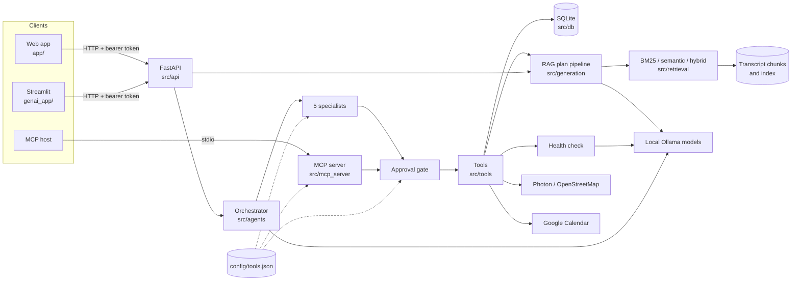
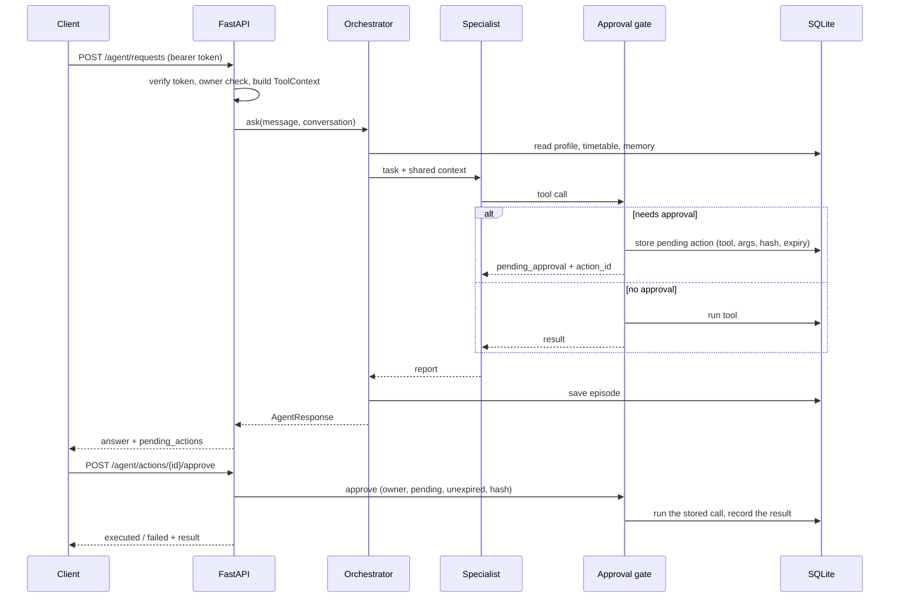

# Architecture

RepWise is built around one rule: **nothing a model says is trusted until code has
checked it.**

- The frontends only display things.
- FastAPI owns behaviour and storage.
- The RAG pipeline produces a plan, which must pass validation before it is saved.
- The agents choose tools, but they work inside a trusted context, a single tool
  catalog and one approval gate.

## Design decisions

- **The API and the MCP server are the trust boundaries.** They authenticate the
  account, then build a [`ToolContext`](../src/tools/context.py) holding the
  account, database, calendar and session location. Tools and agents only ever
  act inside it. No tool argument names an account.
- **One catalog, one gate.** [`config/tools.json`](../config/tools.json) lists every
  tool. [`approvals.py`](../src/agents/approvals.py) is the only place that decides
  whether a call runs now or waits for the student. See [Agent tools](tools.md).
- **Layers exchange Pydantic models.** Data is validated at each boundary, and tool
  results are typed models, never raw text.
- **Failures stay visible.** A missing index, an unreachable calendar or map
  service, or a failed model call becomes an explicit error. It is never a
  fallback that pretends to work: an unreadable calendar is not "free", and an
  unknown location is not guessed.
- **Validation guards the database.** Only validated plans are saved, including
  plans changed by adaptation or rescheduling. Approval-gated actions run only
  after an authenticated approval.
- **Safety fails closed.** The health check treats an unanswered check as a
  possible concern, and then nothing is adapted automatically.
- **Evaluation reuses production code.** Benchmarks call the real retrievers and
  pipeline.
- **Citations aren't proof.** A source ID shows that a passage was retrieved, not
  that it supports an exercise.

## Repository structure

| Path | What's there |
|---|---|
| [`src/agents/`](../src/agents) | **Agents.** `orchestrator.py` (Plan-and-Execute graph), `specialists.py` (five specialists and their bounded loop), `approvals.py` (pending actions), `memory.py` (semantic and episodic memory), `health.py` (pain/injury check), `metrics.py` (time, tokens and tool timings of each request). |
| [`src/tools/`](../src/tools) | **Tools.** `registry.py` (name → arguments model + function), `catalog.py` (loads `config/tools.json`), `context.py` (trusted context), `results.py` (`ToolFailure`), then one module per area: `profile.py`, `planning.py`, `training.py`, `calendar.py`, `places.py`, `knowledge.py`. |
| [`src/integrations/`](../src/integrations) | External services: `photon.py` (geocoding and nearby search), `google_calendar.py`. |
| [`src/mcp_server/`](../src/mcp_server) | The MCP server; Start it with `python -m src.mcp_server.server`. |
| [`src/api/`](../src/api) | FastAPI: `main.py` (accounts, profiles, plans, feedback, speech), `agent_routes.py` (agent, approvals, saved location), `auth.py`. |
| [`src/db/`](../src/db) | `repository.py` (SQLite schema and account-scoped queries), `demo.py` + `demo_data.json` (synthetic account for tests and demos). |
| [`src/schemas/`](../src/schemas) | Pydantic contracts shared by every layer. Start reading here. |
| [`src/generation/`](../src/generation) | The plan pipeline, validation, and feedback adaptation (`adaptation.py`, shared by the API and the agent). |
| [`src/rag/`](../src/rag), [`src/retrieval/`](../src/retrieval) | Query building, evidence selection, prompts; BM25, semantic, hybrid retrieval, query rewriting and the scope gate; `factory.py` builds the configured retriever. |
| [`src/llm/`](../src/llm) | The boundary to Ollama for plan generation. |
| [`src/ingestion/`](../src/ingestion), [`src/evaluation/`](../src/evaluation) | Corpus preparation; benchmarks, metrics and reports. |
| [`config/`](../config) | `config.py` (every setting, from the environment), `tools.json` (tool catalog), `places.json` (place categories), vocabularies. |
| [`scripts/`](../scripts) | Command-line entry points: `run_agent`, `call_tool`, `mcp_smoke`, `sync_tool_catalog`, `connect_google_calendar`. |
| [`tests/`](../tests) | One folder per layer (`agents`, `tools`, `app`, `db`, ...); `integration/` holds opt-in live tests. |
| [`app/`](../app), [`genai_app/`](../genai_app) | The web frontend and the Streamlit UI. |
| [`docs/`](.) | This documentation. `agent/` holds the original design inputs (agent sheet, planning and memory note). |
| [`notebooks/`](../notebooks), [`evals/`](../evals), [`outputs/`](../outputs), [`prompts/`](../prompts), [`data/`](../data) | Course notebooks, evaluation inputs, saved reports and agent transcripts, the plan prompt, local data. |

## Main data flows

**Plan from the web app** (unchanged contract):
`POST /plans` → `generate_workout_plan` → retrieve → generate → validate → saved
as the active plan. The previous active plan is archived.

**Feedback from the web app**: `POST .../feedback` → health check on the comment
(stored) → `adapt_after_feedback`. That adapts the next unlogged workout, unless a
health concern, an earlier adaptation or the absence of a later workout stops it.

**Agent request**: `POST .../agent/requests` → orchestrator → specialists → tools
through the approval gate → `AgentResponse` with `pending_actions`. Then
`POST .../agent/actions/{id}/approve` → the stored call runs.

## Persistence

All state is in one SQLite file (`REPWISE_DATABASE_PATH`); see
[API and database](api.md#data-model). Plans have a status of `active`, `draft`
or `archived`. New tables and columns are added automatically when the API or the
MCP server starts, so older databases keep working.

## Changing the code

| When you change... | Run | Also |
|---|---|---|
| A tool's arguments, or add a tool | `python -m scripts.sync_tool_catalog`, then `python -m pytest tests\tools -q` | Edit the tool's entry in `config/tools.json`; update [tools.md](tools.md). |
| Agents, approvals, memory, health check | `python -m pytest tests\agents -q` | Then `python -m scripts.run_agent`, because scripted tests can't judge the real model's choices. |
| The MCP server | `python -m pytest tests\tools\test_mcp_server.py -q` and `python -m scripts.mcp_smoke` | |
| API routes | `python -m pytest tests\app -q` | Keep the owner check on every route, and existing contracts compatible. |
| The database | `python -m pytest tests\db -q` | Add columns with `_add_missing_column` so old databases still open. |
| Generation, retrieval, ingestion, evaluation | `python -m pytest tests\generation tests\retrieval tests\ingestion tests\evaluation -q` | See [the RAG pipeline](rag_pipeline.md) and [evaluation](evaluation.md). |

Run `python -m pytest -q` when a change crosses layers, and update the matching
guide in the same change. A test with fakes checks the contract, not model quality.
