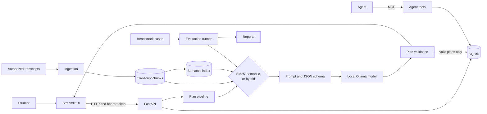

# Architecture

RepWise is built around one rule: nothing the model says is trusted until code has
checked it. Streamlit only displays things, FastAPI owns behavior and storage, and
the pipeline turns transcripts into a plan that must pass validation before it's
saved.

## Design decisions

- **The API is the trust boundary.** The UI never opens the database or calls the
  model, so every rule is enforced in one place.
- **Layers exchange Pydantic models.** Data is converted at each boundary rather
  than passing database rows or raw model output through the app.
- **Failures stay visible.** A missing index stops semantic retrieval with an error
  instead of quietly using BM25, so reported behavior always matches the configured
  setup. For the same reason, too little evidence stops generation rather than
  padding the prompt.
- **Validation guards the database.** Only completed, validated plans are stored.
- **Evaluation reuses production code.** The benchmarks call the real retrievers, so
  there's no second ranking implementation that could drift.
- **Citations aren't proof.** A source ID shows that a passage was retrieved, not
  that it supports the exercise. The UI marks generated exercises as not
  independently verified.

## Repository map

| Path | What's there |
|---|---|
| [`app/`](../app) | Streamlit views and the API client. |
| [`src/api/`](../src/api) | Routes, authentication, HTTP errors. |
| [`src/db/`](../src/db) | SQLite schema and account-scoped storage. |
| [`src/schemas/`](../src/schemas) | Pydantic contracts shared by every layer. Start reading here. |
| [`src/generation/`](../src/generation) | The plan pipeline, validation, and feedback adaptation. |
| [`src/rag/`](../src/rag) | Query building, evidence selection, prompts, response schema. |
| [`src/retrieval/`](../src/retrieval) | Retriever protocol, BM25, semantic, hybrid, query rewriting, index CLI. |
| [`src/llm/`](../src/llm) | The boundary to Ollama. |
| [`src/ingestion/`](../src/ingestion) | Turns transcripts into passages, chunks, and coverage reports. |
| [`src/tools/`](../src/tools) | `generate_workout_plan`, the RAG pipeline as a callable tool. |
| [`src/evaluation/`](../src/evaluation) | Datasets, adapters, metrics, judge, runner, reports. |
| [`agentic/`](../agentic) | Agent tools, MCP server, and demo scripts. [`server.py`](../server.py) starts the server. |
| [`config/`](../config) | Settings and vocabularies (body parts, topics, transcript corrections). |
| [`prompts/`](../prompts) | Versioned system prompt. |
| [`evals/`](../evals) | Benchmark, retrieval, evidence, red-team, and smoke inputs. |
| [`outputs/`](../outputs) | Saved evaluation reports. |
| [`data/`](../data) | Corpus metadata, plus local-only transcripts, chunks, index, and database. |

Each function's docstring is the detailed reference for its behavior.

## Changing the code

| When you change... | Run | Also |
|---|---|---|
| Streamlit or API behavior | `python -m pytest tests\app -q` | Keep account ownership checks on every data path. |
| The database | `python -m pytest tests\db -q` | There are no schema migrations; see [API and database](api.md#data-model). |
| Generation or validation | `python -m pytest tests\generation -q` | Save plans only after validation passes. |
| Ingestion | `python -m pytest tests\ingestion -q` | Rebuild chunks and the index, then recheck dataset links. |
| Retrieval | `python -m pytest tests\retrieval -q` | Keep the shared retriever contract, and compare on the same labels. |
| Evaluation | `python -m pytest tests\evaluation -q` | Keep datasets, metrics, and report wording in line. Try a smoke run first. |
| Agent tools | `python -m pytest tests\agentic tests\tools -q` | Regenerate `docs/agent/s2_tool_schemas.json` if a tool's schema changes. |
| Logging | `python -m pytest tests\test_observability.py -q` | Never log passwords, tokens, or the signing secret. |

Run `python -m pytest -q` when a change crosses layers, and update the matching
guide in the same change. A test with fakes checks the contract, not model quality.
