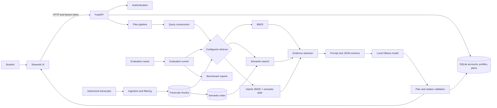

# RepWise architecture

This guide maps the repository for developers who are new to the project. It
describes the current implementation and why the main boundaries exist; it is
not a deployment or medical-safety certification.

## At a glance

RepWise is a local-first workout-planning demo. Streamlit is the user interface,
FastAPI owns application behavior and persistence, a retrieval-augmented
generation pipeline builds and validates plans, and the local corpus provides
transcript evidence.



The request, corpus, and plan contracts live in Pydantic models. Each layer
converts data at a boundary instead of sharing database rows, raw JSON, or model
responses throughout the application.

## Source map

| Area | Responsibility |
|---|---|
| [`app/streamlit_app.py`](../app/streamlit_app.py) | UI and HTTP client. It does not open the database or call Ollama directly. |
| [`src/api/`](../src/api) | FastAPI routes, request authentication, account/profile/plan orchestration, and HTTP error handling. |
| [`src/db/repository.py`](../src/db/repository.py) | SQLite schema and account-scoped persistence. |
| [`src/schemas/models.py`](../src/schemas/models.py) | Shared input, retrieved-evidence, plan, and API data models. |
| [`src/generation/pipeline.py`](../src/generation/pipeline.py) | Orchestrates retrieval, evidence selection, generation, retries, and final validation. |
| [`src/generation/adaptation.py`](../src/generation/adaptation.py) | Applies feedback to one later, unlogged workout while preserving its exercises and source references. |
| [`src/retrieval/`](../src/retrieval) | Common retriever protocol, BM25, local semantic search, hybrid rank fusion, and index construction. |
| [`src/rag/`](../src/rag) | Query/evidence preparation and prompt/schema construction. |
| [`src/llm/ollama.py`](../src/llm/ollama.py) | Small client boundary to the configured local Ollama service. |
| [`src/ingestion/`](../src/ingestion) | Converts authorized source passages into clean chunks and coverage reports. |
| [`src/evaluation/`](../src/evaluation) | Benchmark data loading, adapters, metrics, runner, and reports. |
| [`config/`](../config) | Environment-backed runtime and evaluation settings, plus retrieval lexicons. |
| [`tests/`](../tests) | Contract, behavior, regression, and dataset-linkage tests. |

Generated corpus chunks, embeddings, model weights, logs, evaluation output, and
the local database are runtime artifacts rather than source. Their exact paths
are configurable where the application needs to support alternate local
corpora or environments.

## Main request path

1. The student signs in and submits plan options through Streamlit. The UI sends
   HTTP requests to FastAPI and holds the access token for authenticated
   requests; it does not duplicate backend business logic.
2. FastAPI verifies the signed bearer token, scopes database operations to the
   account ID, validates the profile and plan options, and constructs a
   `PlanRequest`.
3. `PlanPipeline` turns the request into a retrieval query. The selected
   retriever returns ranked `RetrievedChunk` models. Configuration cannot
   lower the generation retrieval depth below five; if fewer than five chunks
   are returned, generation stops with an explicit insufficient-evidence
   result rather than padding the list.
4. Evidence selection assigns source IDs and retains the complete text of each
   selected chunk. Source IDs identify citations in a plan; chunk IDs identify
   corpus records and are not interchangeable.
5. The prompt builder combines the request, evidence, system prompt, and
   `TrainingPlan` JSON schema. The Ollama adapter requests structured output
   from the configured local model.
6. Pydantic parses the response. `validate_plan` checks structural and request
   constraints such as week count, workout frequency, available days, duration,
   equipment, and source membership. Validation does not require verbatim
   quotes, so sources in other languages do not block an English plan. It can
   trigger correction attempts; failed plans are returned as errors and are
   not persisted as completed plans.
7. FastAPI saves successful plans and their source information. Streamlit
   renders the plan, source links, full evidence extracts, and saved history.

Students can also log completion and difficulty for a saved workout. The API
stores one feedback record per workout and may use it to adjust only the next
unlogged workout in that plan. It preserves exercise identities and citations;
feedback does not create a new plan or implement longitudinal progression.
Comments matching the current English pain/discomfort safeguard are saved
without changing a workout.

The source IDs identify retrieved passages but do not prove that a passage
semantically supports an exercise or that the plan is safe. The system is a
training suggestion demo, not a medical or coaching authority. Plans are
requested in clear English regardless of the request or evidence language. The
UI marks every generated exercise as not independently verified because
transcript citations do not establish effectiveness or safety.

## Corpus and retrieval path

The ingestion pipeline consumes prepared transcript passages and metadata.
Passages carrying flags are filtered before chunk creation so later retrieval
does not need to repeat that exclusion. Chunks preserve video IDs, passage
IDs, timestamps, titles, URLs, topics, and body-part hints. Their stable IDs
are derived from their source passage range.

Three production retrievers implement a common search contract:

* **BM25** provides lexical matching using chunk content and searchable
  metadata. It is the no-embedding baseline.
* **Semantic** embeds corpus text once and compares query vectors against the
  local index. Index metadata fingerprints the corpus/model inputs so stale or
  incompatible indexes fail visibly.
* **Hybrid** combines BM25 and semantic rankings with Reciprocal Rank Fusion.
  Rank fusion is used because the component score scales are not directly
  comparable.

The system does not silently substitute BM25 when the configured semantic
model or index is unavailable. This keeps reported behavior consistent with
the selected configuration; setup problems are surfaced rather than disguised
as successful retrieval.

## Persistence and security boundaries

SQLite is the local persistence layer. The repository owns SQL and scopes
student data by authenticated account ID. Passwords are stored as Argon2
hashes; signed bearer tokens carry the internal account identity. Raw passwords
and tokens are not persisted. Environment secrets belong in the local `.env`,
not in source control.

Workout feedback is stored separately and associated with its owned plan and
week/workout position. A successful adaptation updates the plan and records
which future workout was changed in the same database transaction.

The API is the trust boundary for application operations. Streamlit is a
separate process and calls that API. The demo has not been reviewed for
deployment on an untrusted network; local-first behavior should not be read as
production hardening.

## Evaluation architecture

The evaluation runner measures retrieval and generation separately:

* Retrieval cases compare rankings against human-labeled source spans.
* Generation cases exercise planner outputs against expected statuses,
  request constraints, schema rules, and configured text checks.
* Red-team cases are a separate robustness set; they are not mixed into model
  ranking and do not constitute a complete safety evaluation.

[`src/evaluation/adapters.py`](../src/evaluation/adapters.py) normalizes these
components to runner callables. Built-in BM25, semantic, and hybrid
benchmarks delegate to the production retrieval classes rather than keeping a
second evaluation-only ranking algorithm. The real planner adapter passes all
case options into the application request model. The no-RAG comparison uses the
same model, prompt/schema, and validation path but removes retrieved evidence,
so it measures the retrieval contribution without changing the planner stack.

Evaluation results are descriptive measurements, not proof of semantic
grounding, medical safety, or statistical significance. Reports retain
per-case failures and metric denominators so aggregate scores can be audited.

## Development and verification

Use the tests for the layer being changed, then run the full suite when changes
cross boundaries:

```powershell
python -m pytest tests\retrieval tests\generation -q
python -m pytest -q
```

Most tests replace Ollama, HTTP, or database dependencies with focused fakes;
they verify contracts without requiring a running model service. Corpus-linkage
tests need the prepared local corpus. A mocked evaluation run verifies runner
behavior, not model quality. For setup instructions and benchmark commands,
see the [README](../README.md), [generation notes](generation/generation.md),
[retrieval notes](retrieval/hybrid_retrieval.md), and
[evaluation protocol](evaluation_protocol.md).

## Reading the code

Start with the model contracts in `src/schemas/models.py`, then trace a request
from the FastAPI plan route into `PlanPipeline`. Follow its imports into
`src/rag/`, `src/retrieval/`, and `src/llm/ollama.py`. For a corpus change,
start at `src/ingestion/chunker.py`; for benchmark changes, start at
`src/evaluation/runner.py` and follow its dataset, adapter, metric, and report
modules. The function docstrings describe parameter intent, return contracts,
and design decisions at those boundaries.
