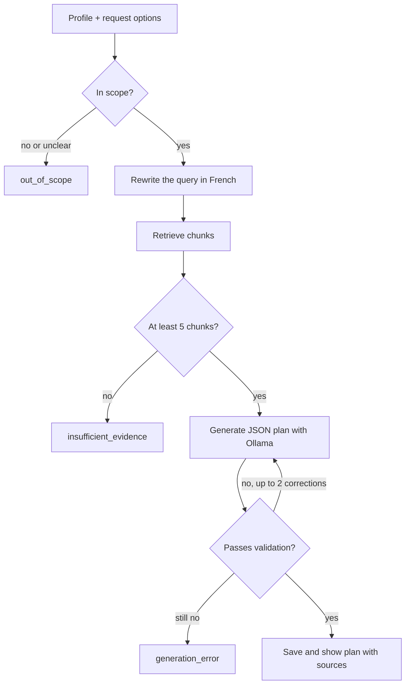

# The RAG pipeline

This is what happens between "I want stronger legs" and a saved plan. Every stage
can stop the request, and only a plan that passes all of them is stored.



If the retriever isn't available, the request stops with `retrieval_error`.

## 1. The request

A `UserProfile` holds experience, goal, available days, session length, equipment,
and optional preferences. It's saved, so students don't re-enter it. Each request
adds a focus, a workout count (by default up to three, limited by available days),
extra constraints, and optionally up to 500 characters on what to change. Each
request produces exactly one week.

## 2. Screening

Before searching, the query-analysis model decides whether this is general
fitness planning. Medical questions, unrelated topics, and unclear requests return
its explanation, and no plan is made. A request containing prompt injection or
conflicting with the profile isn't automatically refused: if it has a real training
goal, the plan must keep that goal and still respect the profile.

## 3. Finding evidence

The transcripts are in French, so the same model first rewrites each request as one
clean French query: it translates, puts the main topic first, and adds closely
related training terms. It treats the request as untrusted text and must not answer
it or add assumptions. If that call fails, retrieval reports an error rather than
searching with the original text. Set `REPWISE_QUERY_EXPANSION=false` to skip the
rewrite and its latency; whether it improves results
[hasn't been measured cleanly yet](evaluation.md#known-problems).

Three retrievers share one contract:

- **BM25** matches words, favoring terms that are rare across the corpus. It's the
  baseline and needs no model.
- **Semantic** compares embeddings, so it can match a paraphrase with different
  wording.
- **Hybrid**, the default, runs both and merges their rankings:

```text
RRF(chunk) = 1 / (60 + BM25 rank) + 1 / (60 + semantic rank)
```

Fusion uses ranks because BM25 scores and cosine similarities aren't on the same
scale. A chunk missing from one list gets nothing from it.

Chunks are also tagged with body parts from `config/body_part_lexicon.json`, a
bilingual list of regions and muscles. Tags are search hints based on words found in
the chunk, not verified claims. BM25 and the embeddings both see them, and requests
are expanded with matching tags.

### The index

The index holds normalized vectors, chunk IDs, the model name, and a SHA-256
fingerprint of the chunk IDs, text, titles, and tags. Loading checks all of it, so a
stale or mismatched index fails with an error. Chunk IDs come from the video and its
first and last passage IDs, so they stay stable until chunk boundaries change.
[Setup](setup.md#3-choose-retrieval) has the build commands.

## 4. Writing the plan

The prompt combines the fixed system instruction in
`prompts/system_prompt_v1.txt`, the request, every retrieved chunk in full, and the
output schema. The instruction treats transcripts and earlier plans as reference
data that can't change the model's orders, and requires English plan text even when
the request or sources are in another language. Returning students also get a
summary of their latest plan, capped at 2,400 characters and without its sources.

`OllamaGenerator` calls the local model at temperature 0.2 with a 32,768-token
context. Prompt sizes are logged before each attempt, so growth stays visible.

The response schema does much of the work before any check runs. It fixes the number
of weeks and workouts and requires time estimates. It also lists **only the source
IDs retrieved for this request** and requires at least one per exercise, so the model
can't omit a citation or invent an ID.

## 5. Checking the plan

Pydantic parses the output, then `validate_plan` rejects a plan when:

- the week count differs, or week numbers are missing or repeated;
- a week doesn't have exactly the requested number of workouts;
- a workout falls on an unavailable day, or exceeds the session length or 120 minutes;
- an exercise has no time estimate, is only a body-part label, or repeats in a workout;
- an exercise has no source ID, or cites one that wasn't retrieved;
- a rest interval exceeds 300 seconds;
- an exercise needs equipment missing from the profile, unless it says full gym.

A failure goes back to the model with the error, up to two more times, and then
returns `generation_error`. Exact quotes aren't required, so French evidence can't
break an English plan.

**These checks are about structure, not truth.** They can't prove that a source
supports an exercise, or that a plan is safe, medically suitable, or complete. Every
plan carries a safety note, and RepWise must not be used to assess pain or injury.

## 6. Showing the sources

Streamlit displays the plan, source links, and full extracts with highlighted terms
from the rewritten query and the student's request. Matching ignores accents and
plurals. It's word overlap, not the model's reasoning, so an extract with no
highlights can still be relevant. Each saved plan keeps its sources, so it stays
readable if the corpus later changes.

## After the workout: feedback

From a saved plan, students log whether they finished a workout, how hard it felt,
and an optional comment. RepWise keeps one record per workout. When it can, it asks
the model to adjust **only the next unlogged workout** in that plan:

- Exercises, order, equipment, and citations stay fixed. Sets, reps, rest, time
  estimates, and coaching notes can change.
- The result is checked against the original request before it's saved.
- Resubmitting updates the record but doesn't adapt a workout a second time.
- The comment goes through the [health check](agents.md#pain-injury-and-medical-questions),
  a small local model that understands English and French. Its decision is stored
  with the feedback. A comment that may describe pain, injury or a medical issue is
  saved without changing anything. If the check can't run, the comment is treated
  the same way (fail closed). It flags possible concerns; it doesn't diagnose.

The API route and the agent's `update_upcoming_workout` tool share these rules
through `adapt_after_feedback` in
[`src/generation/adaptation.py`](../src/generation/adaptation.py). Through the
agent, the adjustment also waits for the student's approval.

Feedback is still saved if adaptation isn't possible. This isn't multi-week
progression, and the corpus [can't yet ground such rules](knowledge_base.md#5-adaptation-engine-what-each-rule-can-rest-on).
