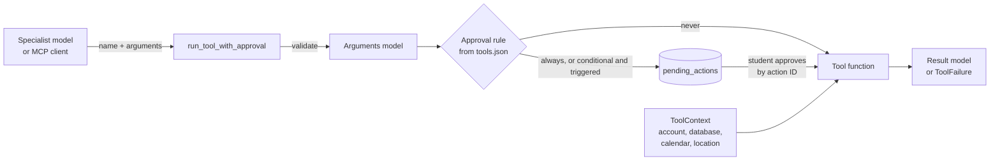

# Agent tools

RepWise has **19 tools**, and [`config/tools.json`](../config/tools.json) is the
only place they are listed. The agents and the MCP server read their names,
descriptions, owner agents, read/write access, approval rules and failure
codes from that file at runtime. The Python side lives in
[`src/tools/registry.py`](../src/tools/registry.py), which maps each name to
the arguments the model may send and to the function that runs.

Each catalog entry has two generated fields, `input_schema` and
`output_models`. `python -m scripts.sync_tool_catalog` refreshes them from the
Pydantic models. `tests/tools/test_catalog.py` (and the MCP server at startup)
fails if the catalog and the code disagree: a tool missing on either side, or
a schema out of date.

## How a tool call runs



- **The model never chooses the account.** No tool takes a `student_id`, a token,
  a database path or coordinates. The trusted
  [`ToolContext`](../src/tools/context.py) supplies them. The API builds it after
  checking the bearer token, and the MCP server builds it after checking its
  startup token.
- **Every result is typed.** A success model has `"ok": true`. A failure is a
  `ToolFailure` with `"ok": false`, a stable `code` and a readable `error`. A
  database problem becomes `storage_error` rather than an exception.
- **The gate can fail any call.** On top of each tool's own codes, any call can
  return `invalid_arguments` (the arguments don't match the schema),
  `unknown_tool`, or `tool_crashed` (an unexpected bug, logged in full).
- **A held call changes nothing.** It returns `{"status": "pending_approval",
  "action_id": ..., "reason": ...}`. See
  [the approval flow](agents.md#approvals).

## Inventory

**Bold** parameters are required. "Owner" is the agent responsible for the tool;
agents in brackets may also call it.

| Tool | Owner | Access | Needs approval | Parameters | Success output | External services |
|---|---|---|---|---|---|---|
| `get_user_profile` | Orchestrator | read | No | (none) | `ProfileResult` | - |
| `get_current_plan` | Orchestrator | read | No | (none) | `CurrentPlanResult` | - |
| `get_timetable` | Orchestrator | read | No | (none) | `TimetableResult` | - |
| `get_workout` | Orchestrator | read | No | **week_number**, **workout_index**, plan_id | `WorkoutResult` | - |
| `remember_fact` | Orchestrator | write | No | **fact** | `FactResult` | Ollama (health check) |
| `get_workout_history` | Planning (Performance) | read | No | max_plans | `HistoryResult` | - |
| `generate_workout_plan` | Planning | write | No: a plan that would replace the active one is saved as a draft | **focus**, workouts_per_week, extra_constraints, refinement_instructions | `GenerateWorkoutPlanResult` | Ollama, fitness corpus |
| `activate_plan` | Planning | write | Always | **plan_id** | `ActivatePlanResult` | - |
| `save_recommendation` | Planning (Performance) | write | No (it changes nothing) | **summary**, **reason**, source_ids, plan_id | `RecommendationResult` | - |
| `save_workout_feedback` | Performance | write | When the comment may describe pain or injury | **week_number**, **workout_index**, **completion_status**, **difficulty**, comment, plan_id | `FeedbackResult` | Ollama (health check) |
| `log_workout_performance` | Performance | write | No | **week_number**, **workout_index**, **exercises**, plan_id | `PerformanceResult` | - |
| `update_upcoming_workout` | Performance | write | Always | **week_number**, **workout_index**, plan_id | `UpdatedWorkoutResult` | Ollama |
| `get_calendar_busy` | Schedule | read | No | start_date, days | `BusyResult` | Google Calendar |
| `propose_training_slots` | Schedule | read | No | week_start, earliest, latest | `SlotsResult` | Google Calendar |
| `organize_schedule` | Schedule | write | Always | moves *or* catch_up_week (+ from_day), plan_id | `ScheduleResult` | - |
| `add_workouts_to_calendar` | Schedule | write | Always | **bookings**, plan_id | `BookingResult` | Google Calendar |
| `get_location` | Location | read | No | place | `LocationResult` | Photon (OpenStreetMap) |
| `search_nearby_places` | Location | read | No | **category**, place, radius_km | `PlacesResult` | Photon (OpenStreetMap) |
| `search_documents` | Knowledge | read | No | **query**, top_k | `SearchResult` | Fitness corpus, Ollama (health check) |

`plan_id` is always optional; without it, a tool works on the student's current
active plan.

## What each tool does

### Orchestrator: shared context

- **`get_user_profile`**: the saved profile (experience, goal, available days,
  session length, equipment, preferences). Fails with `student_not_found`.
- **`get_current_plan`**: the newest *active* plan and the sources it cites.
  Drafts waiting for approval are never the current plan. Fails with
  `plan_not_found`.
- **`get_timetable`**: available days, plus every workout of the current plan with
  the `week_number`/`workout_index` other tools need, its feedback and its calendar
  booking. Without a plan, the list is empty, not an error.
- **`get_workout`**: one workout with its feedback, booking and logged weights and
  reps. Fails with `plan_not_found` or `workout_not_found`.
- **`remember_fact`**: semantic memory (see [Memory](agents.md#memory)). A fact the
  health check flags is refused with `health_not_stored`.

The orchestrator runs the first three in code once per request, to build the
context every specialist shares. It runs `get_workout` when a plan step refers to
one workout.

### Workout Planning

- **`generate_workout_plan`**: runs the [RAG pipeline](rag_pipeline.md). It
  retrieves evidence, generates a one-week plan with the local model and validates
  it against the profile and the evidence. It saves only a valid plan. A student's
  first plan becomes active. If an active plan already exists, the new one is
  saved as a **draft**, and an `activate_plan` action is proposed for approval
  automatically. Failure statuses: `missing_profile`, `invalid_request`,
  `out_of_scope`, `retrieval_error`, `insufficient_evidence`, `generation_error`,
  `unavailable`.
- **`activate_plan`**: makes a draft the active plan and archives the previous
  one. The previous plan is kept, not deleted.
- **`get_workout_history`**: logged workouts (completed, partial and missed), their
  difficulty, weights and reps, and pending recommendations. Code computes the
  summary counts, including `health_concern_reports`. A new student gets empty
  lists.
- **`save_recommendation`**: keeps a proposed change and its supporting
  `source_ids` for later review.

### Performance & Adaptation

- **`save_workout_feedback`**: records completion (`not_completed` for a missed
  workout), difficulty and a comment. The comment goes through the health check
  once, and the decision is **stored with the feedback** (`health_concern`).
- **`log_workout_performance`**: weights, sets and reps per exercise. All names are
  checked against the workout first, so one wrong name saves nothing
  (`exercise_not_found`).
- **`update_upcoming_workout`**: adapts the **next unlogged** workout from the
  feedback on a logged one, using the same rules as the API (see
  [`adapt_after_feedback`](../src/generation/adaptation.py)):
  - only sets, reps, rest, duration and notes may change;
  - one logged workout adapts at most one later workout (`already_adapted`);
  - feedback flagged as a possible health concern stops it (`health_concern`),
    without calling the model.

  Other refusals are `feedback_not_found`, `no_upcoming_workout`, `unavailable`
  and `adaptation_failed`.

### Schedule & Calendar

These tools share one rule: without a connected calendar, they return
`calendar_not_connected` and never invent free time. A calendar that can't be read
returns `calendar_unavailable`, never "free".

- **`get_calendar_busy`**: busy times, with no event titles.
- **`propose_training_slots`**: free start times for each unbooked, unlogged
  workout, with real dates in the student's time zone (daylight saving is
  handled). A workout keeps its planned day when it can. Otherwise its options go
  on another available day that week. Two workouts are never offered the same
  time.
- **`organize_schedule`**: moves workouts to other available days. All the moves
  apply, or none do, and two moves can swap days. After missed workouts, pass
  `catch_up_week` instead of `moves`: code puts the missed workouts first on the
  available days left in that week (after the last logged workout, or from
  `from_day`), then the workouts not done yet. The catch-up is turned into exact
  moves *before* the approval, so the student approves, and the action stores,
  the concrete change; the approval message lists every move. Failures:
  `day_not_available`, `day_conflict`, `invalid_schedule`,
  `nothing_to_catch_up`, `no_day_left`. The result lists calendar events that
  now show an old time.
- **`add_workouts_to_calendar`**: rechecks each chosen time, then creates one event
  per workout, using a stable key so a retry never duplicates it. Each booking has
  its own outcome: `booked`, `already_booked`, `conflict` or `failed`.

### Location

- **`get_location`**: resolves where to search. It tries a place name from the
  request (geocoded), then a location the app shared for this request, then the
  location the student chose to save. Searches are limited to the
  `service_area` of [`config/places.json`](../config/places.json), metropolitan
  France for now. A place name resolves to the map service's **best** match,
  which must be in France: "Berlin" or "Bruxelles" are refused rather than
  replaced by a French village of the same name (adding a postcode picks the
  French place). A country or region ("France", "Val-de-Marne") is too vague
  for a nearby search. Shared or saved coordinates outside the area are
  refused. Failures: `location_unknown`, `place_not_found`, `place_too_vague`,
  `outside_service_area`, `invalid_request`, `places_unavailable`.
- **`search_nearby_places`**: searches one category from
  [`config/places.json`](../config/places.json) (`gym`, `sports_store`,
  `supplement_store`). Places come nearest first, with name, address,
  coordinates, a distance computed by code, an OpenStreetMap link and the data
  attribution. Code drops places outside the area and places whose name shows
  they are unrelated to strength training (`exclude_name_hints`: fencing,
  running, golf or yoga shops and studios, organic grocers, ...), matched as
  whole words without accents, before the model sees the list.
  `name_suggests_fitness_equipment` is only a hint taken from shop names
  (`fitness_name_hints`). Both lists are in the same file. Map data can't
  confirm stock or opening hours.

### Fitness Knowledge

- **`search_documents`**: returns passages from the curated corpus, using the
  configured retriever, with `source_id`, title and link. It never generates
  advice. When nothing matches, `evidence_found` is `false`. Pain and injury
  questions are refused (`health_question`). Other failures are
  `search_unavailable` and `out_of_scope`.

## Trying a tool without a model

```powershell
python -m scripts.call_tool --list
python -m scripts.call_tool get_timetable
python -m scripts.call_tool search_nearby_places '{\"category\": \"gym\"}'
python -m scripts.call_tool organize_schedule '{\"moves\": [{\"week_number\": 1, \"workout_index\": 0, \"new_day\": \"Saturday\"}]}' --approve
```

This runs on a temporary database with the synthetic account. A held call prints
`pending_approval`. With `--approve`, the script approves it through the same
service the API uses.

## Adding or changing a tool

1. Write the function in `src/tools/` (or `src/agents/memory.py`), taking a
   `ToolContext` first and returning a result model or a `ToolFailure`.
2. Add an arguments model and an entry in `IMPLEMENTATIONS` in
   `src/tools/registry.py`.
3. Add the tool to `config/tools.json`: its description, `agents`, `access`,
   `approval` (with `approval_reason`) and `failure_codes`.
4. Run `python -m scripts.sync_tool_catalog`, then `python -m pytest tests/tools -q`.
